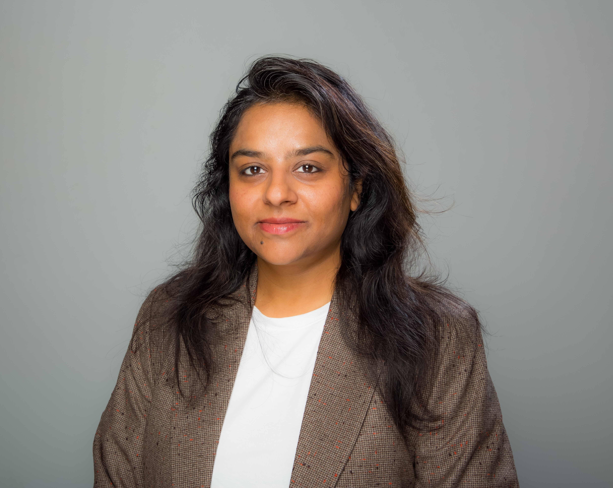

{fig-align="center"}

:::::::::: columns
::::::: {.column width="50%"}
## About

::::: name-block
::: name-en
Rimjhim Saxena
:::

::: name-sub
Rim-Jim Sax-éna  ·  रिमझिम सक्सेना
:::
:::::

My name is Rimjhim Saxena . I am a **Postdoctoral Researcher at the Institute of Economics and Econometrics (IEE) at the Geneva School of Economics and Management (GSEM) at the University of Geneva, Switzerland**. I graduated with my PhD in Economics from the [University of Colorado, Boulder](https://www.colorado.edu/economics/) in May 2025. I like working at the intersection of Climate + Development, preferably with a good coffee.

::: location-trail
🇮🇳Lucknow [·]{style="margin: 0 8px; color: var(--rs-border)"} 🇺🇸Boston [·]{style="margin: 0 8px; color: var(--rs-border)"} 🇺🇸Boulder [·]{style="margin: 0 8px; color: var(--rs-border)"} 🇨🇭[Geneva]{.current}
:::

```{=html}
<!-- 
<a href="/pdfs/research_statement.pdf" class="paper-status jm">RESEARCH STATEMENT</a>
<a href="/pdfs/teaching_statement.pdf" class="paper-status jm">TEACHING STATEMENT</a>
-->
```
:::::::

::: {.column width="10%"}
<!-- empty column to create gap -->
:::

::: {.column width="35%"}
{fig-align="right" width="1000"}
:::
::::::::::

### Upcoming whereabouts:

1.  [Seminar, UC Dublin Economics](https://www.ucd.ie/economics/research/researchseminars/) Oct 19, Dublin, Ireland [INVITED]{.paper-status .invited}

2.  [4th CERIS Workshop, University of Galway](https://www.universityofgalway.ie/ceris/annualworkshop/) Oct 14-15, Galway, Ireland

3.  [European Association for Labour Economics (EALE) 2026](https://www.ub.edu/eale2026/) Aug 31-Sept 2, 2026, Barcelona, Spain

4.  [Spatial Economics of Environmental Change Workshop](https://www.sciencespo.fr/department-economics/events/workshop-on-spatial-economics-of-environmental-change/), June 26, 2026, Paris, France [INVITED GUEST SPEAKER]{.paper-status .invited}

5.  [Paris Environmental Economics Workshop](https://www.parisschoolofeconomics.eu/en/events/paris-environmental-economics-workshop/) April 7-8, 2026, Paris, France

6.  [AERE \@ OSWEET](https://www.aere.org/osweet-paper-sessions) May 8, 2026, Virtual

### Research Interests

- Environmental Economics
- Development Economics
- Climate Change Adaptation
