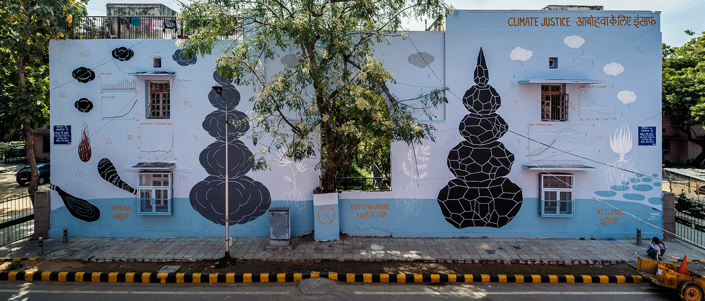
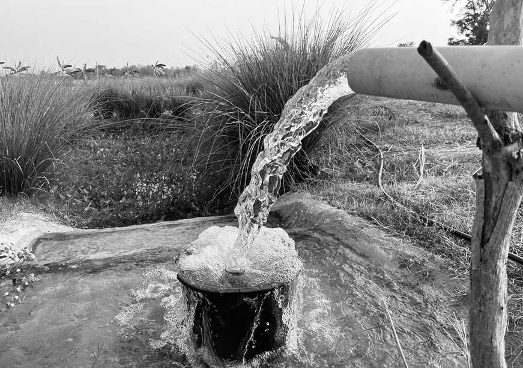
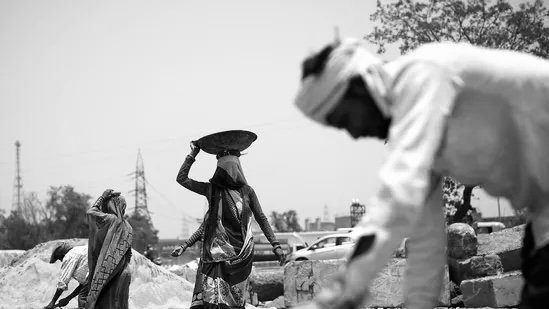

## Working Papers

[Fuel vs. Water: Is Ethanol Renewable?]{.paper-title-link} [JOB MARKET PAPER]{.paper-status .jm}

::: paper-versions
<a href="/pdfs/Saxena_ethanol_JMP.pdf">Working Paper</a>
:::

::::: columns
::: {.column width="65%"}

Abstract

 Is ethanol a renewable resource? Renewability is contingent on ethanol's feedstock production to not be dependent on non-renewable resources, such as unpriced groundwater. I study India's ethanol mandate, which reached a 10% blend in 2022 and 20% blend in 2025 from 1.5% in 2014, using water-intensive feedstock crops such as sugarcane, rice, maize, and wheat. Using a shift-share design, I find that mandate exposure shifts cultivation towards water-intensive feedstock crops, and that a one standard deviation increase in mandate exposure reduces groundwater levels by 11.34 cm. Farmers receive electricity at zero marginal cost which erodes the scarcity value of water, but states impose electricity ration in number of hours. I find that a tight ration gates mandate's effect on groundwater, however the effect rises in hours of electricity supply. How much the mandate reaches farmers depends on the ethanol distillery market structure they face. I compile a new dataset of ethanol distillery locations, entry dates, capacity, and feedstock used, across India. I use this data to define local market structure. I find that moving a district from monopsony to competition increases mandate-driven depletion by 3.33 cm.  Who captures the resulting unpriced-groundwater subsidy? the farmer or the distillery, depends on market structure, catchment feedstock saturation, and under government-administered procurement, on a guaranteed minimum margin paid to the distillery. Translating these results into district-level renewability status, I find the mandate tips eleven districts from renewable into non-renewable groundwater status. Ethanol is not a renewable resource as currently produced in India. A renewable fuel mandate cannot be designed or evaluated as a standalone policy without pairing it with water and electricity pricing reform in a second-best world.

:::

::: {.column width="35%"}
{width="200"}
:::
:::::

[Barriers within Borders: Climate Change, Market Barriers, and Structural Transformation]{.paper-title-link}

::: paper-versions
<a href="/pdfs/Saxena_BWB.pdf">Working Paper</a>
:::

::::: columns
::: {.column width="65%"}

Abstract

 This paper examines how climate change is hindering structural transformation in India and the role of internal trade barriers in it. I combine local temperature effects on productivity, consumption, and labor shares with a static spatial equilibrium model to evaluate the potential for labor reallocation out of agriculture as an adaptation to climate change. My empirical findings show that temperature has a more negative impact on agricultural productivity than on manufacturing (supply-side effect), and household expenditure on food increases as incomes fall, consistent with Engel’s law (demand-side effect). Rising temperatures also increase the agricultural labor share, hindering structural transformation. Districts in India could mitigate against the adverse effects of declining agricultural productivity through inter-district trade. Using a market access variable created by using development of Indian highways, I find that improved market access does not disrupt the positive relationship between temperature and agricultural labor share. I find that trade barriers reduce spatial competition among buyers and traps labor in low-productivity agriculture. I then calibrate a spatial equilibrium model with internal trade barriers to Indian data. Counterfactual analysis reveals that removing state-level trade barriers in Indian agriculture will increase income by 4.65% on average for each household and decrease agricultural labor share by 0.1pp on average for each district (\~ 28.9 million people across India).

:::

::: {.column width="35%"}
{width="200"}
:::
:::::

[Stumped by the Sun, Saved by the Side: How Do Teams Adapt to Heat? Evidence on Peer Adaptation]{.paper-title-link} [SUBMITTED]{.paper-status .submitted}

::: paper-versions
<a href="https://papers.ssrn.com/sol3/papers.cfm?abstract_id=6516018">SSRN</a> [·]{.sep} <a href="/pdfs/SBS_cricket_aug26.pdf">Working Paper</a>
:::

::::: columns
::: {.column width="65%"}

Abstract

 How do teams respond to temperature when individual productivity declines? Using high-frequency data from international cricket, I examine how heat affects team production. Individual productivity declines by 1.46%–2.68% per degree Celsius, yet equilibrium output, jointly determined by individual effort, peer coordination, and adversarial pressure, remains unaffected. Decomposing equilibrium output into individual, peer, and adversarial components, I find that peer interactions become significantly more important under heat while adversarial interactions remain unchanged, indicating that peers, not weaker opponents, offset the individual decline. This adaptation is driven by complementarity in skills among peers.

:::

::: {.column width="35%"}
{width="200"}
:::
:::::

## Works in progress

- Local Impacts of Global Policies: Deforestation and the European Union Deforestation Regulation (EUDR) (with [Matthieu Stigler](https://matthieustigler.github.io) and [Sabine Stillger](https://sites.google.com/view/sabinestillger/home))

- Fragile Flames: Geopolitical Shocks and Clean Energy Transition

- Misallocation of Water and Crops: Water Rights, Market Distortions, and Trade Barriers in India (with [Bhavya Srivastava](https://www.bhavyasrivastava.com) and [Elizabeth Sorensen Montoya](https://www.elizabethsorensenmontoya.com))

- Climate Change and Informal Insurance Networks (with [Matthew Gordon](https://sites.google.com/view/mdgordon/home))

## Book Chapters

- [Understanding the Gender Gap in Education and Employment](https://www.cambridge.org/core/books/abs/colossus/education-understanding-the-gender-gap-in-education-and-employment/163763A3D320223894A3E7F31DFD46D4) Chapter in *Colossus : The anatomy of Delhi ,* edited by Sanjoy Chakravorty and Neelanjan Sircar. Cambridge University Press (2021) (with Deepaboli Chatterjee and Babu Lal)
